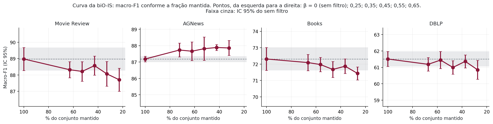

# Relatório de resultados: RQ1, RQ2 e RQ3 (rodada final)

> **Finalidade:** reunir os números da rodada final para escrever as Seções 5.1, 5.2 e 5.3 do artigo
> ("Supervisão gerada por múltiplos anotadores LLM").
> Todos os valores foram calculados sobre as pastas listadas abaixo.
> **Reprodução:** [resultados_rq1_rq3.ipynb](resultados_rq1_rq3.ipynb) (executado em 2026-10-14). Saídas em
> `data/results/mq/resultados_rq1_rq3/` (JSON + um CSV por tabela) e `data/results/mq/comparacao_supervisao/`.

## 0. Fontes e convenções

| Dataset | Anotação + consenso + fine-tuning | Sem filtro | Com biO-IS (β=0,25, θ=0,5) | 2 fases (RQ3) |
|---|---|---|---|---|
| Movie Review | `movie_review/2026-09-24_12-48-42` | `v1_roberta-base` | `v2_roberta-base_bio-is` | — |
| AGNews | `agnews/2026-10-08_02-20-35` | `v1_roberta-base` | `v2_roberta-base_bio-is` | — |
| Books | `books/2026-09-13_07-19-54` | `v1_roberta-base_aggregated` | `v2_roberta-base_aggregated_bio-is` | `books/two_phase/2026-09-18_17-03-05` |
| DBLP | `dblp/2026-09-13_18-46-30` | `v1_roberta-base_aggregated` | `v2_roberta-base_aggregated_bio-is` | `dblp/two_phase/2026-09-18_17-03-44` |

- **Benchmark por fold:** `data/results/mq/Roberta - Catizani.xlsx`, aba `effect-fold` (`mac0…mac9`). Médias: Movie Review 89,04, AGNews 94,26, Books 87,21 e DBLP 81,44. Os quatro batem com o RoBERTa publicado por Cunha et al. (2025).
- **Métrica principal:** macro-F1. A acurácia vem em paralelo. Todos os valores estão em pontos percentuais (pp).
- **Comparação de sistemas = comparação pareada por fold:**
  - Calcula-se dᵢ = Aᵢ − Bᵢ em cada fold; a conclusão vem do **IC 95% (t de Student) da média de dᵢ**: se o IC contém 0, os sistemas são equivalentes.
  - Complemento: t pareado com correção de Bonferroni (FWER) e de Benjamini-Hochberg (FDR).
  - Cada família de contraste é corrigida separadamente, com m = 4 (um teste por dataset) nas RQ1/RQ2 e m = 8 (2 datasets × 4 sistemas) na RQ3.
  - Reporta-se também o **IC ajustado por Bonferroni** (nível 1 − 0,05/m). Ele é o critério coerente com o p corrigido.
- **Consenso (voto majoritário):**
  - 1x1x1 é a discordância total (três rótulos distintos, contando -1 como rótulo). Esses textos ficam **fora** das métricas do consenso, como faz o fine-tuning.
  - O `sumario_experimento.json` do pipeline, ao contrário, mantém os 1x1x1 com o rótulo do DeepSeek (desempate do `Counter`). Os dois valores aparecem lado a lado na Tabela 2.2.
- **O que vai para o fine-tuning:** além dos 1x1x1, o treino descarta todo texto em que algum modelo deu resposta inválida (`remove_invalid_vote_instances`). A coluna "Aptos ao treino" da Tabela 2.3 reflete as duas remoções.
  - Essa segunda remoção entrou no código em 2026-10-08, **depois** das execuções sem filtro e com biO-IS (β = 0,25) desta tabela. Essas execuções treinaram com os textos de voto inválido; só ficaram fora os 1x1x1.
  - Daqui em diante, toda execução nova (pontos da curva β da §3.6 e regimes da RQ6) já sai com a remoção. Ver a §3.6 para o efeito na curva.
- **κ de Fleiss** recalculado com -1 como categoria própria. O cálculo do pipeline descarta os votos -1 mas mantém n = 3 na fórmula, o que gera uma diferença pequena (≤ 0,004).
- **Métricas por modelo:** acurácia e macro-F1 sobre as predições válidas (≠ -1). A taxa de inválidas é reportada à parte; é a convenção do `evaluate_model_metrics`.

## Resumo geral: fine-tuning do RoBERTa-base

Macro-F1 médio entre os folds, com a meia-largura do IC 95% entre parênteses (t de Student). Em todas as colunas, a avaliação é sempre contra os benchmark labels do conjunto de teste. Os testes e os ICs das diferenças estão nas §2.5, §3.3 e §3.4.

| Dataset | Classes | Folds | κ de Fleiss (3 LLMs) | Anotação humana (benchmark) | Consolidada sem filtro | Consolidada com filtro (biO-IS) |
|---|---|---|---|---|---|---|
| Movie Review | 2 | 10 | 0,842 | 89,04 (0,67) | 88,98 (0,70) | 88,32 (0,49) |
| AGNews | 4 | 5 | 0,907 | 94,26 (0,28) | 87,19 (0,17) | 87,73 (0,42) |
| Books | 8 | 10 | 0,744 | 87,21 (0,58) | 72,31 (0,69) | 72,09 (0,49) |
| DBLP | 10 | 10 | 0,738 | 81,44 (0,53) | 61,51 (0,45) | 61,19 (0,41) |

O κ de Fleiss mede a concordância entre os três anotadores sobre todos os textos do dataset, com a resposta inválida (-1) tratada como categoria própria (detalhes na §2.2).

## 2. RQ1: anotação consolidada × anotação humana

### 2.1 Qualidade de cada anotador

| Dataset | DeepSeek-R1 (F1 / Acc) | Qwen3 (F1 / Acc) | Llama 3.1 (F1 / Acc) | Inválidas % (DS · Qw · Ll) |
|---|---|---|---|---|
| Movie Review | 89,45 / 89,46 | **91,51** / 91,51 | 89,60 / 89,60 | 1,00 · 0,00 · 0,01 |
| AGNews | 84,87 / 85,19 | **86,43** / 86,62 | 86,34 / 86,48 | 0,22 · 0,00 · 0,00 |
| Books | 63,96 / 61,90 | **73,33** / 71,97 | 72,57 / 71,57 | 0,62 · 0,00 · 0,01 |
| DBLP | 58,30 / 61,19 | **60,02** / 63,30 | 59,32 / 59,87 | 0,42 · 0,00 · 0,00 |

- O Qwen3 lidera em todos os datasets, mas o Llama 3.1 fica a menos de 0,8 pp dele em AGNews, Books e DBLP. Os dois são próximos e complementares; o DeepSeek-R1 é o mais fraco.
- A taxa de inválidas fica em ≤ 1,0% em todos os casos e se concentra no DeepSeek-R1 (máximo de 1,00% no Movie Review). Qwen3 e Llama 3.1 praticamente não erram o formato.
- O DeepSeek-R1 fica 9,4 pp atrás do Qwen3 em Books. Como a métrica exclui as inválidas, essa distância é de erro real de classificação e não de saída inválida.

### 2.2 Rótulo consolidado

| Dataset | Acurácia | Macro-F1 | Δ vs. melhor modelo (pp) | κ de Fleiss | sumário do pipeline (Acc / F1 / κ) |
|---|---|---|---|---|---|
| Movie Review | 91,32 | 91,32 | −0,19 | 0,842 | 91,32 / 91,32 / 0,838 |
| AGNews | 86,95 | 86,73 | +0,30 | 0,907 | 86,78 / 86,56 / 0,907 |
| Books | 71,84 | 73,27 | −0,06 | 0,744 | 70,40 / 71,86 / 0,743 |
| DBLP | 64,78 | 62,03 | +2,01 | 0,738 | 63,42 / 60,92 / 0,738 |

### 2.3 Padrões de concordância e o que vai para o treino

| Dataset | Textos | 3x0 | 2x1 | 1x1x1 | c/ voto inválido | Aptos ao treino | κ Cohen (DS–Qw · DS–Ll · Qw–Ll) |
|---|---|---|---|---|---|---|---|
| Movie Review | 10.662 | 9.400 (88,2%) | 1.240 (11,6%) | 22 (0,2%) | 107 | 10.555 | 0,857 · 0,811 · 0,858 |
| AGNews | 127.600 | 114.596 (89,8%) | 12.665 (9,9%) | 339 (0,3%) | 283 | 126.999 | 0,919 · 0,889 · 0,914 |
| Books | 33.594 | 23.007 (68,5%) | 9.778 (29,1%) | 809 (2,4%) | 211 | 32.617 | 0,723 · 0,702 · 0,808 |
| DBLP | 38.053 | 25.823 (67,9%) | 11.176 (29,4%) | 1.054 (2,8%) | 161 | 36.868 | 0,795 · 0,684 · 0,741 |

Qualidade do consenso por padrão de concordância (macro-F1 / acurácia):

| Dataset | 3x0 (F1 / Acc) | 2x1 (F1 / Acc) |
|---|---|---|
| Movie Review | 94,59 / 94,60 | 66,40 / 66,51 |
| AGNews | 89,43 / 90,10 | 60,08 / 58,41 |
| Books | 79,18 / 78,56 | 55,38 / 56,03 |
| DBLP | 68,61 / 73,69 | 42,71 / 44,20 |

- **Consenso × melhor modelo:** o voto majoritário fica no nível do melhor modelo individual, com Δ entre −0,19 e +2,01 pp. Ele supera o melhor modelo em AGNews e, com folga, em DBLP (+2,0 pp).
- **Concordância:** o κ de Fleiss vai de 0,738 a 0,907 (de bom a excelente) e é menor nos dois datasets de maior granularidade.
- **Discordância total:** são 22, 339, 809 e 1.054 casos 1x1x1 (0,2% a 2,8% dos textos). A fração de 2x1 sobe de cerca de 10% (2 e 4 classes) para cerca de 29% (8 e 10 classes).
- **Qualidade por padrão:** nos 2x1 o macro-F1 cai entre 24 e 29 pp em relação aos 3x0, em todos os datasets. Esse dado também serve para a RQ5.

### 2.4 Fine-tuning: média entre folds com IC 95% (formato do benchmark)

Macro-F1 médio entre os folds e, entre parênteses, a meia-largura do IC 95% (t de Student), no mesmo formato da Tabela 2 de Cunha et al. (2025). As colunas de anotação LLM e a coluna "benchmark por fold" foram calculadas sobre os folds; as duas colunas do benchmark publicado foram copiadas dos artigos.

| Dataset | Folds | Benchmark RoBERTa publicado (Cunha et al., 2025) | Benchmark por fold (`effect-fold`) | Consolidada sem filtro | Consolidada com biO-IS | Benchmark + biO-IS publicado (humano) |
|---|---|---|---|---|---|---|
| Movie Review | 10 | 89,0 (0,7) | 89,04 (0,67) | 88,98 (0,70) | 88,32 (0,49) | 88,3 (0,4) |
| AGNews | 5 | 94,2 (0,2) | 94,26 (0,28) | 87,19 (0,17) | 87,73 (0,42) | 94,0 (0,2) |
| Books | 10 | 87,2 (0,6) | 87,21 (0,58) | 72,31 (0,69) | 72,09 (0,49) | 86,5 (0,6) |
| DBLP | 10 | 81,4 (0,5) | 81,44 (0,53) | 61,51 (0,45) | 61,19 (0,41) | 80,5 (0,6) |

Acurácia das consolidadas (o benchmark publica só macro-F1):

| Dataset | Sem filtro | Com biO-IS |
|---|---|---|
| Movie Review | 88,98 (0,70) | 88,32 (0,49) |
| AGNews | 87,33 (0,18) | 87,80 (0,40) |
| Books | 71,12 (0,72) | 70,82 (0,54) |
| DBLP | 63,79 (0,24) | 63,57 (0,44) |

Nos quatro datasets, a média e o IC calculados sobre os folds da aba `effect-fold` coincidem com a Tabela 2 de Cunha et al. (2025). A diferença no AGNews (94,26 contra 94,2) é só de arredondamento.

### 2.5 Fine-tuning: consolidada × benchmark, pareado por fold

| Dataset | Folds | Benchmark (F1, IC95) | Consolidada (F1, IC95) | Δ = bench − cons. (IC95) | IC Bonferroni | p Bonf. | p BH | Conclusão (IC95) |
|---|---|---|---|---|---|---|---|---|
| Movie Review | 10 | 89,04 [88,37; 89,71] | 88,98 [88,27; 89,68] | +0,07 [−0,58; +0,71] | [−0,82; +0,95] | 1,0000 | 0,8182 | equivalentes |
| AGNews | 5 | 94,26 [93,98; 94,54] | 87,19 [87,02; 87,36] | +7,07 [+6,92; +7,23] | [+6,84; +7,31] | <10⁻⁴ | <10⁻⁴ | benchmark melhor |
| Books | 10 | 87,21 [86,63; 87,78] | 72,31 [71,62; 73,01] | +14,89 [+14,23; +15,56] | [+13,98; +15,81] | <10⁻⁴ | <10⁻⁴ | benchmark melhor |
| DBLP | 10 | 81,44 [80,92; 81,97] | 61,51 [61,06; 61,97] | +19,93 [+19,45; +20,41] | [+19,27; +20,59] | <10⁻⁴ | <10⁻⁴ | benchmark melhor |

- O benchmark não tem acurácia por fold, então a acurácia só pode ser reportada de forma individual. Acurácia da consolidada, sem filtro: 88,98 [88,28; 89,68], 87,33 [87,15; 87,50], 71,12 [70,39; 71,84] e 63,79 [63,54; 64,03].
- Convenção do Δ: benchmark − consolidada (positivo ⇒ benchmark melhor). Para apresentar como "consolidada − benchmark", basta inverter o sinal.

**Leitura para o texto (RQ1)**
- **Movie Review (2 classes):** a anotação consolidada é **estatisticamente equivalente** ao benchmark. A diferença pareada é de +0,07 pp com IC [−0,58; +0,71], que contém o zero (p corrigido = 1,0).
- **Demais datasets:** o benchmark é superior. O gap cresce com a granularidade:
  - +7,1 pp no AGNews (4 classes);
  - +14,9 pp em Books (8 classes);
  - +19,9 pp em DBLP (10 classes).
  - Todos esses gaps têm p < 10⁻⁴ após a correção.
- **Origem do gap:** ele acompanha a qualidade do rótulo de treino. O consolidado tem 73,27 de macro-F1 em Books e 62,03 em DBLP contra o benchmark (Tabela 2.2), e o classificador termina em 72,31 e 61,51. Ou seja, o RoBERTa reproduz quase exatamente o teto imposto pela anotação.

## 3. RQ2: filtragem por seleção de instâncias (biO-IS)

A entrada da biO-IS é o `dataset_consenso.csv` sem os 1x1x1. Por isso "Entrada" difere de "Aptos ao treino" (§2.3).

### 3.1 O que é removido

| Dataset | Entrada | Removido | Ruidosas | Redundantes | Red.:ruído | Erro entre ruidosas | Erro entre redundantes |
|---|---|---|---|---|---|---|---|
| Movie Review | 10.639 | 37,2% | 1.294 | 2.659 | 2,1:1 | 18,8% | 5,0% |
| AGNews | 127.261 | 27,8% | 3.521 | 31.815 | 9,0:1 | 52,6% | 9,8% |
| Books | 32.785 | 33,6% | 2.824 | 8.196 | 2,9:1 | 49,1% | 22,2% |
| DBLP | 36.999 | 32,6% | 2.817 | 9.249 | 3,3:1 | 64,7% | 26,6% |

**Como ler as colunas de erro.** Cada coluna de erro é uma **taxa dentro do próprio grupo**: o número de instâncias do grupo cujo rótulo consolidado diverge do benchmark label, dividido pelo tamanho do grupo. São denominadores diferentes, então essas porcentagens **não se somam** e não devem fechar 100%. No Movie Review:
- **Erro entre ruidosas = 18,8%:** das 1.294 instâncias removidas como ruído, 243 estavam erradas e 1.051 (81,2%) estavam certas.
- **Erro entre redundantes = 5,0%:** das 2.659 removidas como redundantes, 134 estavam erradas e 2.525 (95,0%) estavam certas.
- **Erro nas mantidas = 8,17%** (§3.2): das 6.686 que seguem para o treino, 546 estão erradas.

A pergunta "para onde vão os erros?" é respondida pela segunda tabela da §3.2, que divide o total de erros da entrada entre os três destinos e soma 100%.

**Classificador fraco da biO-IS (regressão logística sobre TF-IDF).**

| Dataset | Classes | Instâncias | Acurácia | Macro-F1 |
|---|---|---|---|---|
| Movie Review | 2 | 10.639 | 75,67 | 75,63 |
| AGNews | 4 | 127.261 | 94,47 | 94,17 |
| Books | 8 | 32.785 | 82,77 | 82,83 |
| DBLP | 10 | 36.999 | 84,77 | 78,36 |

- **Contra o quê é medido:** as métricas são calculadas **contra o rótulo consolidado dos LLMs**, que é a supervisão que a biO-IS usa, e **não contra o benchmark label**. Elas medem o quanto a regressão logística consegue reproduzir a anotação dos LLMs.
- **Como é avaliado:** cada instância recebe a predição de um modelo que não a viu no treino (validação cruzada estratificada de 5 partes sobre toda a entrada).
- **Mesmo classificador em toda a curva:** o classificador fraco não depende de β, então é o mesmo em todos os pontos da curva (§3.6), com valores idênticos nos relatórios de β = 0,25 a 0,65.
- **Papel na seleção:** os acertos dele definem o grupo de onde saem as redundantes e os erros definem o grupo de onde saem as ruidosas. Por isso, quanto mais fraco o classificador, menos precisa é a separação entre os dois grupos. O Movie Review é o caso mais fraco (75,6 de macro-F1).

### 3.2 A filtragem limpa o conjunto que sobra?

| Dataset | Erro na entrada | Erro nas removidas | Erro nas mantidas | Δ erro mantido (pp) | Erros capturados | Removidas corretas | Removidas 3x0 | 3x0 entre ruidosas / redundantes | F1 classif. fraco |
|---|---|---|---|---|---|---|---|---|---|
| Movie Review | 8,68% | 9,54% | 8,17% | −0,51 | 40,8% | 90,5% | 87,1% | 76,7% / 92,1% | 0,756 |
| AGNews | 13,05% | 14,10% | 12,65% | −0,40 | 30,0% | 85,9% | 88,5% | 37,9% / 94,1% | 0,942 |
| Books | 28,16% | 29,08% | 27,69% | −0,47 | 34,7% | 70,9% | 67,2% | 33,1% / 78,9% | 0,828 |
| DBLP | 35,22% | 35,49% | 35,09% | −0,13 | 32,9% | 64,5% | 68,6% | 33,8% / 79,2% | 0,784 |

Assim como na §3.1, as colunas "Erro na entrada", "Erro nas removidas" e "Erro nas mantidas" são taxas dentro de cada grupo e não se somam. "Δ erro mantido" é a diferença, em pp, entre o erro nas mantidas e o erro na entrada. Ela mostra quanto o conjunto de treino ficou mais limpo.

**Para onde vão os erros.** A tabela abaixo usa outro denominador: o **total de erros da entrada**. Cada erro tem exatamente um destino (removido como ruído, removido como redundância ou mantido no treino), então cada linha soma 100%:

| Dataset | Erros na entrada | Removidos como ruído | Removidos como redundância | Ficam no conjunto mantido |
|---|---|---|---|---|
| Movie Review | 923 (8,68% da entrada) | 243 (26,3%) | 134 (14,5%) | 546 (59,2%) |
| AGNews | 16.613 (13,05%) | 1.851 (11,1%) | 3.130 (18,8%) | 11.632 (70,0%) |
| Books | 9.231 (28,16%) | 1.386 (15,0%) | 1.819 (19,7%) | 6.026 (65,3%) |
| DBLP | 13.031 (35,22%) | 1.823 (14,0%) | 2.459 (18,9%) | 8.749 (67,1%) |

- **Erros capturados:** ruído + redundância formam os "Erros capturados" da tabela anterior (30,0% a 40,8%). Por exemplo, no Movie Review são 26,3% + 14,5% = 40,8%.
- **Erros que ficam:** a maior parte dos erros (59% a 70%) permanece no conjunto mantido.
- **Por que a taxa quase não muda:** o filtro também remove muitas instâncias corretas, então o conjunto encolhe junto com os erros. No Movie Review saem 377 erros (243 + 134) mas também 3.576 acertos, e a taxa de erro do treino só passa de 8,68% para 8,17%.

Erro por tipo de remoção e padrão de concordância:

| Dataset | Ruidosa · 3x0 | Ruidosa · 2x1 | Redundante · 3x0 | Redundante · 2x1 |
|---|---|---|---|---|
| Movie Review | 12,1% (n=993) | 40,9% (n=301) | 3,2% (n=2.450) | 26,3% (n=209) |
| AGNews | 42,3% (n=1.336) | 58,9% (n=2.185) | 8,6% (n=29.932) | 29,3% (n=1.883) |
| Books | 39,4% (n=935) | 53,9% (n=1.889) | 18,4% (n=6.468) | 36,2% (n=1.728) |
| DBLP | 56,5% (n=952) | 68,9% (n=1.865) | 21,7% (n=7.321) | 45,0% (n=1.928) |

**Este é o achado que explica o resultado nulo da filtragem.**
- O método separa bem os dois grupos: o erro entre as ruidosas é 2,2 a 5,4 vezes maior que entre as redundantes. Mesmo assim, **o conjunto mantido fica praticamente tão ruidoso quanto a entrada**: a taxa de erro cai só 0,13 a 0,51 pp.
- **Volume:** as ruidosas são poucas, entre 10% e 33% das remoções. A redundância domina e remove sobretudo casos corretos e 3x0: entre 64,5% e 90,5% das removidas estavam certas, e entre 67,2% e 88,5% eram 3x0.
- **Erros capturados:** a filtragem retira de 30,0% a 40,8% de todos os erros. Como retira junto uma massa ainda maior de acertos, a proporção de erro nas mantidas quase não muda.
- **Ruidosas 3x0:** nas ruidosas com unanimidade o erro é alto em AGNews, Books e DBLP (39% a 57%). São casos em que os três modelos concordam entre si e divergem do benchmark, o que liga este resultado à RQ4.

### 3.3 Com × sem filtro, pareado por fold

| Dataset | Sem filtro (F1, IC95) | Com filtro (F1, IC95) | Δ F1 = com − sem (IC95) | IC Bonferroni | p Bonf. | p BH | Conclusão (IC95) | Δ Acc (IC95) | Removido |
|---|---|---|---|---|---|---|---|---|---|
| Movie Review | 88,98 [88,27; 89,68] | 88,32 [87,83; 88,81] | −0,66 [−1,04; −0,27] | [−1,18; −0,13] | 0,0149 | 0,0149 | sem filtro melhor | −0,66 [−1,04; −0,27] | 37,2% |
| AGNews | 87,19 [87,02; 87,36] | 87,73 [87,31; 88,15] | +0,55 [+0,19; +0,91] | [−0,01; +1,10] | 0,0526 | 0,0263 | com filtro melhor | +0,48 [+0,16; +0,80] | 27,8% |
| Books | 72,31 [71,62; 73,01] | 72,09 [71,60; 72,59] | −0,22 [−0,70; +0,26] | [−0,88; +0,44] | 1,0000 | 0,3284 | equivalentes | −0,29 [−0,80; +0,21] | 33,6% |
| DBLP | 61,51 [61,06; 61,97] | 61,19 [60,77; 61,60] | −0,33 [−0,79; +0,14] | [−0,96; +0,31] | 0,5873 | 0,1958 | equivalentes | −0,21 [−0,67; +0,24] | 32,6% |

**Leitura para o texto (RQ2):** o efeito do filtro depende do dataset.
- **Books e DBLP:** equivalentes; o IC contém 0 com e sem correção.
- **Movie Review:** o filtro **custa 0,66 pp**, e o efeito é significativo mesmo com Bonferroni (p = 0,015). O IC de Bonferroni não contém 0.
- **AGNews:** o filtro **ganha 0,55 pp** no IC 95% e no BH (p = 0,026). Com Bonferroni o efeito fica no limite (p = 0,053), e o IC ajustado [−0,01; +1,10] toca o zero.
- **Em todos os casos o efeito é menor que 0,7 pp.** Nenhum deles altera a distância para a anotação humana (§3.4).

### 3.4 Benchmark × consolidada com filtro

| Dataset | Δ F1 = bench − com filtro (IC95) | IC Bonferroni | p Bonf. | p BH | Conclusão (IC95) | Humano: NoSel → biO-IS (Cunha et al., não pareado) |
|---|---|---|---|---|---|---|
| Movie Review | +0,72 [+0,19; +1,26] | [−0,01; +1,46] | 0,0529 | 0,0132 | benchmark melhor | 89.0(0.7) → 88.3(0.4) |
| AGNews | +6,53 [+6,16; +6,89] | [+5,95; +7,10] | <10⁻⁴ | <10⁻⁴ | benchmark melhor | 94.2(0.2) → 94.0(0.2) |
| Books | +15,11 [+14,54; +15,69] | [+14,32; +15,91] | <10⁻⁴ | <10⁻⁴ | benchmark melhor | 87.2(0.6) → 86.5(0.6) |
| DBLP | +20,26 [+19,76; +20,75] | [+19,58; +20,94] | <10⁻⁴ | <10⁻⁴ | benchmark melhor | 81.4(0.5) → 80.5(0.6) |

- **Movie Review:** com o filtro, a equivalência com o benchmark deixa de ser garantida. O IC 95% passa a excluir o zero, mas o IC de Bonferroni [−0,01; +1,46] ainda o toca (p Bonf. = 0,053). Vale escrever "no limite da equivalência".
- **Anotação humana + biO-IS (Cunha et al.):** a última coluna dá uma referência útil para o texto, embora não pareada (só há média e IC). Com rótulos humanos, a biO-IS também custa de 0,2 a 0,9 pp. Isso é da mesma ordem que o custo ou ganho observado aqui (−0,66 a +0,55). O filtro se comporta de forma parecida sob os dois tipos de supervisão.

### 3.5 Leitura consolidada da RQ2 (as duas funções da Seção 4.2)

- **Correção da anotação: não acontece.**
  - O método localiza o erro: as ruidosas têm de 18,8% a 64,7% de erro, contra 5,0% a 26,6% nas redundantes.
  - Mesmo assim, não purifica o que sobra (−0,13 a −0,51 pp de erro).
  - O gap para a anotação humana fica essencialmente inalterado: 0,7 a 20,3 pp com filtro, contra 0,1 a 19,9 pp sem filtro.
  - O ruído que explica o gap não está num subconjunto isolável.
- **Redução do treino: confirmada, com uma ressalva.**
  - Com 27,8% a 37,2% menos instâncias, o desempenho é equivalente em Books e DBLP e ligeiramente superior em AGNews.
  - Em Movie Review custa 0,66 pp. É o dataset com a maior fração removida (37,2%) e o classificador fraco mais fraco (F1 0,756).
  - A curva (§3.6) estende o resultado: mantendo só 23% a 32% da entrada (β = 0,65), a perda máxima é de 1,27 pp (Movie Review), e AGNews segue acima do sem filtro.

### 3.6 Curva % mantido × macro-F1

**Configuração.** θ fica fixo em 0,5 e β varia: 0 (sem filtro), 0,25 (a execução das §3.3 e §3.4), 0,35, 0,45, 0,55 e 0,65.
- θ fixo significa que a **remoção de ruído é a mesma em todos os pontos** (1.294, 3.521, 2.824 e 2.817 instâncias). Ao longo da curva, só cresce a remoção de **redundantes**.
- "% mantido" é a fração da entrada da biO-IS que sobra (mantidas ÷ entrada), a mesma base da §3.1.
- Cada ponto é comparado ao sem filtro de forma pareada por fold, com Δ = com filtro − sem filtro.
- Correção de múltiplas comparações:
  - β = 0,25 usa a família da §3.3 (m = 4);
  - os pontos de β = 0,35 a 0,65 formam uma família própria (m = 16, 4 pontos × 4 datasets).
- Nenhum ponto saturou: em todos, a remoção redundante pedida (β × entrada) coube entre os acertos do classificador fraco.

*Figura: macro-F1 (IC 95%) conforme a fração mantida. Os pontos vão, da esquerda para a direita, de β = 0 (sem filtro) a β = 0,65. A faixa cinza é o IC 95% do sem filtro. Os quatro painéis usam o mesmo eixo x e uma janela de mesma altura no eixo y (4,8 pp), para que as inclinações sejam comparáveis.*

Movie Review:

| β | % mantido | Mantidas | Redundantes / ruidosas removidas | Macro-F1 (IC95) | Δ vs. sem filtro (IC95) | IC Bonferroni | p Bonf. | p BH | Conclusão (IC95) |
|---|---|---|---|---|---|---|---|---|---|
| 0 (sem filtro) | 100,0% | 10.639 | — | 88,98 (0,70) | — | — | — | — | — |
| 0,25 | 62,8% | 6.686 | 2.659 / 1.294 | 88,32 (0,49) | −0,66 [−1,04; −0,27] | [−1,18; −0,13] | 0,0149 | 0,0149 | sem filtro melhor |
| 0,35 | 52,8% | 5.622 | 3.723 / 1.294 | 88,22 (0,60) | −0,76 [−1,26; −0,26] | [−1,64; +0,12] | 0,1174 | 0,0196 | sem filtro melhor |
| 0,45 | 42,8% | 4.558 | 4.787 / 1.294 | 88,57 (0,58) | −0,41 [−1,00; +0,18] | [−1,45; +0,64] | 1,0000 | 0,1898 | equivalentes |
| 0,55 | 32,8% | 3.494 | 5.851 / 1.294 | 88,07 (0,76) | −0,91 [−1,28; −0,54] | [−1,56; −0,26] | 0,0053 | 0,0053 | sem filtro melhor |
| 0,65 | 22,8% | 2.430 | 6.915 / 1.294 | 87,71 (0,70) | −1,27 [−1,89; −0,64] | [−2,37; −0,16] | 0,0209 | 0,0070 | sem filtro melhor |

AGNews:

| β | % mantido | Mantidas | Redundantes / ruidosas removidas | Macro-F1 (IC95) | Δ vs. sem filtro (IC95) | IC Bonferroni | p Bonf. | p BH | Conclusão (IC95) |
|---|---|---|---|---|---|---|---|---|---|
| 0 (sem filtro) | 100,0% | 127.261 | — | 87,19 (0,17) | — | — | — | — | — |
| 0,25 | 72,2% | 91.925 | 31.815 / 3.521 | 87,73 (0,42) | +0,55 [+0,19; +0,91] | [−0,01; +1,10] | 0,0526 | 0,0263 | com filtro melhor |
| 0,35 | 62,2% | 79.199 | 44.541 / 3.521 | 87,66 (0,56) | +0,47 [−0,15; +1,09] | [−0,95; +1,90] | 1,0000 | 0,1469 | equivalentes |
| 0,45 | 52,2% | 66.473 | 57.267 / 3.521 | 87,82 (0,71) | +0,63 [−0,00; +1,26] | [−0,82; +2,07] | 0,8065 | 0,0807 | equivalentes |
| 0,55 | 42,2% | 53.747 | 69.993 / 3.521 | 87,89 (0,18) | +0,70 [+0,39; +1,01] | [−0,01; +1,41] | 0,0520 | 0,0104 | com filtro melhor |
| 0,65 | 32,2% | 41.021 | 82.719 / 3.521 | 87,86 (0,45) | +0,67 [+0,18; +1,17] | [−0,46; +1,80] | 0,3068 | 0,0438 | com filtro melhor |

Books:

| β | % mantido | Mantidas | Redundantes / ruidosas removidas | Macro-F1 (IC95) | Δ vs. sem filtro (IC95) | IC Bonferroni | p Bonf. | p BH | Conclusão (IC95) |
|---|---|---|---|---|---|---|---|---|---|
| 0 (sem filtro) | 100,0% | 32.785 | — | 72,31 (0,69) | — | — | — | — | — |
| 0,25 | 66,4% | 21.765 | 8.196 / 2.824 | 72,09 (0,49) | −0,22 [−0,70; +0,26] | [−0,88; +0,44] | 1,0000 | 0,3284 | equivalentes |
| 0,35 | 56,4% | 18.487 | 11.474 / 2.824 | 71,97 (0,44) | −0,34 [−1,01; +0,33] | [−1,52; +0,84] | 1,0000 | 0,3211 | equivalentes |
| 0,45 | 46,4% | 15.208 | 14.753 / 2.824 | 71,67 (0,49) | −0,64 [−1,27; −0,00] | [−1,76; +0,48] | 0,7842 | 0,0807 | sem filtro melhor¹ |
| 0,55 | 36,4% | 11.930 | 18.031 / 2.824 | 71,87 (0,44) | −0,44 [−1,01; +0,13] | [−1,45; +0,56] | 1,0000 | 0,1515 | equivalentes |
| 0,65 | 26,4% | 8.651 | 21.310 / 2.824 | 71,43 (0,40) | −0,88 [−1,76; −0,00] | [−2,43; +0,67] | 0,7858 | 0,0807 | sem filtro melhor¹ |

DBLP:

| β | % mantido | Mantidas | Redundantes / ruidosas removidas | Macro-F1 (IC95) | Δ vs. sem filtro (IC95) | IC Bonferroni | p Bonf. | p BH | Conclusão (IC95) |
|---|---|---|---|---|---|---|---|---|---|
| 0 (sem filtro) | 100,0% | 36.999 | — | 61,51 (0,45) | — | — | — | — | — |
| 0,25 | 67,4% | 24.933 | 9.249 / 2.817 | 61,19 (0,41) | −0,33 [−0,79; +0,14] | [−0,96; +0,31] | 0,5873 | 0,1958 | equivalentes |
| 0,35 | 57,4% | 21.233 | 12.949 / 2.817 | 61,45 (0,52) | −0,07 [−0,34; +0,20] | [−0,55; +0,41] | 1,0000 | 0,5946 | equivalentes |
| 0,45 | 47,4% | 17.533 | 16.649 / 2.817 | 60,99 (0,41) | −0,52 [−0,80; −0,23] | [−1,02; −0,01] | 0,0449 | 0,0104 | sem filtro melhor |
| 0,55 | 37,4% | 13.833 | 20.349 / 2.817 | 61,37 (0,40) | −0,15 [−0,50; +0,21] | [−0,78; +0,49] | 1,0000 | 0,4089 | equivalentes |
| 0,65 | 27,4% | 10.133 | 24.049 / 2.817 | 60,85 (0,58) | −0,66 [−0,96; −0,37] | [−1,19; −0,14] | 0,0112 | 0,0056 | sem filtro melhor |

¹ O limite superior do IC 95% fica a menos de 0,01 pp do zero. Com Bonferroni os dois pontos são equivalentes ao sem filtro.

**Leitura para o texto (curva)**
- **A curva é quase plana.** Mesmo mantendo só 22,8% a 32,2% da entrada (β = 0,65), o macro-F1 fica a no máximo 1,27 pp do sem filtro:
  - −1,27 no Movie Review;
  - −0,88 em Books;
  - −0,66 em DBLP;
  - +0,67 em AGNews.
  Essas perdas são bem menores que a distância para a anotação humana nos datasets multiclasse (de 7,1 a 19,9 pp, §2.5).
- **Por dataset, com Bonferroni:**
  - **AGNews:** nenhum ponto perde. Todos ficam de 0,47 a 0,70 pp acima do sem filtro, mas nenhum ganho resiste à correção (o mais forte, β = 0,55, tem p = 0,052). Dá para treinar com 32% dos dados sem perda.
  - **Books:** todos os pontos são equivalentes ao sem filtro. A perda máxima é de 0,88 pp, com 26,4% dos dados.
  - **DBLP:** perdas pequenas mas significativas em β = 0,45 (−0,52) e β = 0,65 (−0,66). β = 0,35 (57,4% mantido) e β = 0,55 (37,4%) são equivalentes.
  - **Movie Review:** é o único com queda clara. Todo ponto perde de 0,41 a 1,27 pp e a perda é significativa com Bonferroni em β = 0,25, 0,55 e 0,65. O Movie Review também é o dataset com o classificador fraco mais fraco (F1 0,756), o que torna a escolha dos redundantes menos precisa.
- **Não há um "joelho" nítido.** A queda é gradual e oscila dentro do IC (por exemplo, β = 0,45 fica abaixo de β = 0,55 em Books e DBLP). O ponto a partir do qual a remoção passa a custar desempenho depende do dataset:
  - em AGNews, nenhum;
  - em Books, nenhum dentro da faixa testada;
  - em DBLP, por volta de 47% mantido;
  - em Movie Review, já no primeiro ponto (62,8%).
- **O que varia na curva é a redundância.** Como a remoção de ruído é fixa (θ = 0,5), todo o efeito ao longo da curva vem de tirar redundantes. Em β = 0,65, 65% da entrada sai como redundante e o desempenho se mantém a menos de 1,3 pp do sem filtro. A anotação gerada pelos LLMs é, portanto, muito redundante.

**Ressalvas:**
- **Base de treino dos pontos (decisão aceita):** os pontos novos (β = 0,35 a 0,65) rodam com a remoção dos textos de voto inválido (§0), e o sem filtro e o β = 0,25 rodaram sem ela. Os pontos antigos treinam, portanto, com alguns textos a mais:

  | Dataset | Textos a mais nos pontos antigos | % dos textos |
  |---|---|---|
  | Movie Review | 85 | 0,80% |
  | AGNews | 262 | 0,21% |
  | Books | 168 | 0,50% |
  | DBLP | 131 | 0,34% |

  - Quase todos os votos inválidos são do DeepSeek-R1; a única exceção é 1 texto do Llama 3.1 em Movie Review.
  - A diferença foi considerada pequena demais para re-rodar o sem filtro e o β = 0,25. Ela deve ser citada como limitação ao apresentar a curva.
  - A avaliação não muda: o conjunto de teste de cada fold continua sendo o do benchmark completo, com esses textos incluídos.

## 4. RQ3: restrição do espaço de rótulos (Books e DBLP)

**Configuração efetiva:**
- 10 folds externos. Em cada um, o held-out é 1/5 do treino do fold: cerca de 6.050 textos em Books e 6.850 em DBLP.
- **Fase 1:** regressão logística sobre TF-IDF, treinada com benchmark labels, devolvendo as Top-3.
- **Fase 2:** os 3 modelos re-anotam vendo só as 3 candidatas.
- **Baseline sem restrição:** é a anotação da rodada final (`books/2026-09-13`, `dblp/2026-09-13`), cruzada por `text_id`. Como o LLM anota texto a texto, a predição sem restrição de cada held-out já existe.
- **Candidatas:** as Top-3 não são salvas pelo pipeline. Elas foram **reconstruídas** refazendo a Fase 1, que é determinística (`CandidateRebuilder`: mesmo dedup, mesmo split interno com seed 42 e mesma regressão logística). A reconstrução foi validada de duas formas:
  - reproduz exatamente o recall@3 salvo em cada um dos 10 folds dos dois datasets;
  - das 382.856 predições válidas da anotação restrita (179.290 em Books e 203.566 em DBLP, nos 3 modelos), **nenhuma** cai fora das candidatas reconstruídas. Como resposta fora das candidatas vira -1, isso só é possível se as listas forem as mesmas que os modelos viram.
- **Sobreposição entre folds:** os held-out se sobrepõem. São 60.470 linhas para 28.193 textos únicos em Books e 68.512 para 32.861 em DBLP. Por isso a inferência é feita **por fold**. As medidas agregadas (erro condicional, matriz, entropia) somam os folds, de modo que um mesmo texto pode contar mais de uma vez, cada vez com candidatas e anotações próprias.

### 4.1 Teto da Fase 1: recall@k (macro / micro, %)

| Dataset | k=2 (macro / micro) | k=3 | k=4 |
|---|---|---|---|
| Books | 92,3 / 93,2 | 96,2 / 97,0 | 97,8 / 98,5 |
| DBLP | 90,3 / 92,9 | 95,2 / 96,8 | 97,4 / 98,3 |

Com k = 3, a classe correta está entre as candidatas em cerca de 96% dos casos (recall@3 macro). O teto fica 21,6 pp acima do macro-F1 do consenso restrito em Books (96,2 contra 74,6) e 30,9 pp acima em DBLP (95,2 contra 64,3).

### 4.2 Restrita × sem restrição, pareado por texto dentro do fold e inferência entre folds

| Dataset | Sistema | F1 sem restrição | F1 restrita | Δ F1 (IC95) | IC Bonferroni (m=8) | p Bonf. | Δ Acc | Inválidas % (sem → restrita) |
|---|---|---|---|---|---|---|---|---|
| Books | DeepSeek-R1 | 63,73 | 67,35 | +3,62 [+3,28; +3,97] | [+3,08; +4,17] | <10⁻⁴ | +3,91 | 0,67 → 0,84 |
| Books | Qwen3 | 72,90 | 74,23 | +1,32 [+1,15; +1,50] | [+1,05; +1,60] | <10⁻⁴ | +1,45 | 0,00 → 0,01 |
| Books | Llama 3.1 | 72,85 | 73,79 | +0,94 [+0,73; +1,14] | [+0,61; +1,26] | <10⁻⁴ | +1,11 | 0,01 → 2,65 |
| Books | Consenso (voto) | 73,28 | 74,57 | +1,30 [+1,16; +1,43] | [+1,09; +1,50] | <10⁻⁴ | +1,44 | 2,46 → 2,03 |
| DBLP | DeepSeek-R1 | 58,08 | 60,71 | +2,63 [+2,14; +3,12] | [+1,86; +3,39] | <10⁻⁴ | +1,56 | 0,41 → 0,45 |
| DBLP | Qwen3 | 59,77 | 61,59 | +1,83 [+1,64; +2,01] | [+1,54; +2,12] | <10⁻⁴ | +1,24 | 0,00 → 0,00 |
| DBLP | Llama 3.1 | 60,13 | 66,05 | +5,91 [+5,69; +6,14] | [+5,56; +6,27] | <10⁻⁴ | +6,32 | 0,00 → 2,42 |
| DBLP | Consenso (voto) | 62,26 | 64,33 | +2,07 [+1,86; +2,28] | [+1,74; +2,40] | <10⁻⁴ | +1,72 | 2,81 → 1,56 |

- **Pareamento:** em cada fold, as métricas usam só os textos válidos nas duas condições.
- **Inválidas do consenso:** é a fração de 1x1x1 ou de maioria -1.
- **Llama 3.1:** passa a responder fora das candidatas em cerca de 2,5% dos textos; essas respostas são marcadas como -1.

### 4.3 Quanto do erro sobrevive quando a classe correta é visível

| Dataset | Sistema | y ∈ Top-3 | P(erro dado y∈Top-3), sem restrição | P(erro dado y∈Top-3), restrita | Δ (pp) | P(erro dado y∉Top-3), sem restrição | Erros da restrita com y∉Top-3 |
|---|---|---|---|---|---|---|---|
| Books | DeepSeek-R1 | 97,0% | 37,4% | 32,4% | −5,0 | 68,9% | 8,6% |
| Books | Qwen3 | 97,0% | 27,2% | 24,6% | −2,6 | 65,4% | 11,3% |
| Books | Llama 3.1 | 97,3% | 27,2% | 25,2% | −2,0 | 67,8% | 10,0% |
| Books | Consenso (voto) | 97,3% | 27,0% | 24,6% | −2,4 | 66,6% | 10,3% |
| DBLP | DeepSeek-R1 | 96,8% | 37,5% | 35,3% | −2,2 | 82,4% | 8,6% |
| DBLP | Qwen3 | 96,8% | 35,3% | 33,4% | −1,9 | 81,1% | 9,1% |
| DBLP | Llama 3.1 | 96,9% | 37,7% | 30,5% | −7,2 | 79,4% | 9,6% |
| DBLP | Consenso (voto) | 96,9% | 33,2% | 30,8% | −2,4 | 81,1% | 9,4% |

- **Erro com a classe correta visível:** mesmo com a classe correta entre as 3 candidatas, o consenso erra **24,6% (Books) e 30,8% (DBLP)** dos textos. Sem a restrição, sobre os mesmos textos, erraria 27,0% e 33,2%. A restrição tira apenas cerca de 2,4 pp do erro.
- **Origem do erro:** cerca de 90% dos erros da anotação restrita acontecem com a classe correta disponível. O erro "imposto pelo filtro" (y∉Top-3) é só 9% a 11% do total.
- **Textos com y∉Top-3:** são difíceis mesmo sem restrição, com 67% a 81% de erro. A Fase 1 tende a errar justamente onde os LLMs também erram.

### 4.4 Erro condicional por classe (consenso)

Books:

| Classe | n (y∈Top-3) | recall@3 | P(erro dado in), sem restrição | P(erro dado in), restrita | Δ (pp) |
|---|---|---|---|---|---|
| history & biography | 7.844 | 98,0% | 51,7% | 49,3% | −2,4 |
| young adult | 7.470 | 96,7% | 42,9% | 30,4% | −12,4 |
| paranormal fantasy | 7.075 | 95,7% | 24,0% | 30,2% | +6,1 |
| graphic comics | 8.261 | 98,2% | 22,5% | 23,2% | +0,8 |
| children | 7.694 | 98,3% | 26,4% | 22,5% | −3,8 |
| romance | 7.528 | 96,2% | 23,3% | 19,2% | −4,1 |
| poetry | 1.920 | 88,8% | 11,4% | 9,5% | −1,9 |
| crime & mystery thriller | 8.532 | 97,5% | 4,7% | 3,6% | −1,1 |

DBLP:

| Classe | n (y∈Top-3) | recall@3 | P(erro dado in), sem restrição | P(erro dado in), restrita | Δ (pp) |
|---|---|---|---|---|---|
| graphics | 7.694 | 99,2% | 91,7% | 87,7% | −4,0 |
| signal processing | 5.194 | 95,1% | 52,2% | 53,8% | +1,6 |
| biomedical engineering | 2.046 | 84,3% | 41,8% | 45,7% | +4,0 |
| security and cryptography | 2.295 | 91,1% | 31,1% | 29,4% | −1,7 |
| theory | 16.818 | 98,4% | 33,2% | 25,2% | −8,1 |
| data mining | 6.591 | 97,0% | 32,6% | 22,6% | −10,0 |
| computer vision | 7.232 | 96,4% | 17,5% | 17,3% | −0,2 |
| robotics | 2.410 | 95,2% | 10,2% | 10,4% | +0,2 |
| computational linguistics | 7.811 | 97,6% | 2,9% | 9,5% | +6,7 |
| software engineering | 5.543 | 97,8% | 5,4% | 8,6% | +3,2 |

- **Classes onde o erro persiste:** o erro com a classe visível é extremo e quase não muda com a restrição.
  - **graphics** (DBLP): 87,7% de erro com recall@3 de 99,2%.
  - **history & biography** (Books): 49,3%.
  - **signal processing** (DBLP): 53,8%.
- **A restrição redistribui o erro entre as classes.**
  - Ganhos grandes: young adult (−12,4 pp), data mining (−10,0) e theory (−8,1).
  - Pioras: paranormal fantasy (+6,1), computational linguistics (+6,7), biomedical engineering (+4,0) e software engineering (+3,2).
  - Nas pioras, uma "classe-ímã" que estava fora da lista passa a competir dentro das 3 candidatas.

### 4.5 Matriz de confusão condicional (consenso restrito, y ∈ Top-3, normalizada por linha)

Books:

| verdadeira \ predita | children | graphic comics | paranormal fantasy | history & biography | crime & mystery thriller | poetry | romance | young adult |
|---|---|---|---|---|---|---|---|---|
| children | **0,77** | 0,00 | 0,04 | 0,02 | 0,03 | 0,01 | 0,00 | 0,11 |
| graphic comics | 0,01 | **0,77** | 0,10 | 0,01 | 0,07 | 0,00 | 0,01 | 0,04 |
| paranormal fantasy | 0,01 | 0,02 | **0,70** | 0,01 | 0,06 | 0,00 | 0,13 | 0,07 |
| history & biography | 0,01 | 0,00 | 0,02 | **0,51** | 0,08 | 0,00 | 0,36 | 0,03 |
| crime & mystery thriller | 0,00 | 0,00 | 0,02 | 0,00 | **0,96** | 0,00 | 0,01 | 0,01 |
| poetry | 0,01 | 0,00 | 0,00 | 0,08 | 0,00 | **0,91** | 0,00 | 0,00 |
| romance | 0,00 | 0,00 | 0,09 | 0,00 | 0,08 | 0,00 | **0,81** | 0,02 |
| young adult | 0,00 | 0,00 | 0,15 | 0,00 | 0,06 | 0,00 | 0,09 | **0,70** |

DBLP:

| verdadeira \ predita | computer vision | computational linguistics | biomedical engineering | software engineering | graphics | data mining | security and cryptography | signal processing | robotics | theory |
|---|---|---|---|---|---|---|---|---|---|---|
| computer vision | **0,83** | 0,01 | 0,03 | 0,00 | 0,01 | 0,04 | 0,00 | 0,04 | 0,01 | 0,03 |
| computational linguistics | 0,00 | **0,90** | 0,00 | 0,01 | 0,00 | 0,01 | 0,00 | 0,00 | 0,00 | 0,07 |
| biomedical engineering | 0,11 | 0,00 | **0,54** | 0,01 | 0,00 | 0,09 | 0,00 | 0,02 | 0,02 | 0,20 |
| software engineering | 0,00 | 0,00 | 0,00 | **0,91** | 0,00 | 0,00 | 0,02 | 0,00 | 0,00 | 0,06 |
| graphics | 0,03 | 0,02 | 0,01 | 0,20 | **0,12** | 0,04 | 0,01 | 0,10 | 0,02 | 0,45 |
| data mining | 0,01 | 0,09 | 0,00 | 0,02 | 0,00 | **0,77** | 0,01 | 0,00 | 0,00 | 0,08 |
| security and cryptography | 0,00 | 0,00 | 0,00 | 0,18 | 0,01 | 0,01 | **0,71** | 0,00 | 0,00 | 0,09 |
| signal processing | 0,04 | 0,02 | 0,00 | 0,01 | 0,00 | 0,01 | 0,04 | **0,46** | 0,00 | 0,40 |
| robotics | 0,06 | 0,00 | 0,02 | 0,00 | 0,00 | 0,00 | 0,00 | 0,01 | **0,90** | 0,01 |
| theory | 0,01 | 0,01 | 0,01 | 0,11 | 0,01 | 0,05 | 0,04 | 0,01 | 0,00 | **0,75** |

### 4.6 Concentração do erro: entropia e pares principais

A entropia normalizada vai de 0 (todos os erros da classe vão para um único alvo) a 1 (erros espalhados uniformemente). A linha "global" usa a distribuição sobre todos os pares (verdadeira → predita).

Books:

| Classe verdadeira | Erros (y∈Top-3) | Entropia normalizada | Alvo principal | Fração no alvo |
|---|---|---|---|---|
| children | 1.733 | 0,74 | young adult | 48,8% |
| graphic comics | 1.920 | 0,69 | paranormal fantasy | 44,0% |
| paranormal fantasy | 2.134 | 0,75 | romance | 41,9% |
| history & biography | 3.867 | 0,47 | romance | 72,5% |
| crime & mystery thriller | 307 | 0,72 | paranormal fantasy | 50,5% |
| poetry | 182 | 0,30 | history & biography | 86,3% |
| romance | 1.444 | 0,52 | paranormal fantasy | 45,6% |
| young adult | 2.272 | 0,57 | paranormal fantasy | 48,3% |
| global (pares) | 13.859 | 0,75 | history & biography → romance | 20,2% |

| Par (verdadeira → predita) | n | Fração dos erros | Acumulado |
|---|---|---|---|
| history & biography → romance | 2.802 | 20,2% | 20,2% |
| young adult → paranormal fantasy | 1.097 | 7,9% | 28,1% |
| paranormal fantasy → romance | 894 | 6,5% | 34,6% |
| children → young adult | 846 | 6,1% | 40,7% |
| graphic comics → paranormal fantasy | 845 | 6,1% | 46,8% |
| young adult → romance | 709 | 5,1% | 51,9% |
| romance → paranormal fantasy | 659 | 4,8% | 56,7% |
| romance → crime & mystery thriller | 604 | 4,4% | 61,0% |

DBLP:

| Classe verdadeira | Erros (y∈Top-3) | Entropia normalizada | Alvo principal | Fração no alvo |
|---|---|---|---|---|
| computer vision | 1.253 | 0,83 | signal processing | 24,1% |
| computational linguistics | 745 | 0,47 | theory | 70,6% |
| biomedical engineering | 936 | 0,65 | theory | 43,6% |
| software engineering | 477 | 0,42 | theory | 66,9% |
| graphics | 6.746 | 0,66 | theory | 51,5% |
| data mining | 1.491 | 0,64 | computational linguistics | 40,4% |
| security and cryptography | 674 | 0,43 | software engineering | 61,9% |
| signal processing | 2.794 | 0,44 | theory | 74,6% |
| robotics | 251 | 0,53 | computer vision | 60,6% |
| theory | 4.230 | 0,75 | software engineering | 42,3% |
| global (pares) | 19.597 | 0,73 | graphics → theory | 17,7% |

| Par (verdadeira → predita) | n | Fração dos erros | Acumulado |
|---|---|---|---|
| graphics → theory | 3.474 | 17,7% | 17,7% |
| signal processing → theory | 2.083 | 10,6% | 28,4% |
| theory → software engineering | 1.790 | 9,1% | 37,5% |
| graphics → software engineering | 1.562 | 8,0% | 45,5% |
| theory → data mining | 904 | 4,6% | 50,1% |
| graphics → signal processing | 762 | 3,9% | 54,0% |
| theory → security and cryptography | 744 | 3,8% | 57,8% |
| data mining → computational linguistics | 603 | 3,1% | 60,8% |

### 4.7 Leitura para o texto (RQ3)

1. **A restrição ajuda, mas pouco.**
   - Todos os sistemas melhoram, e todos de forma significativa após Bonferroni.
   - O consenso ganha **+1,3 pp em Books e +2,1 pp em DBLP**.
   - Os maiores ganhos são do DeepSeek-R1 em Books (+3,6) e do Llama 3.1 em DBLP (+5,9).
   - O ganho do consenso é maior no dataset com mais classes: 10 classes contra 8, ou seja, 7 distratores removidos por texto contra 5.
2. **A busca no espaço de rótulos não é o gargalo.**
   - O teto é de cerca de 96% (recall@3 macro) e a classe correta está visível em cerca de 97% dos textos.
   - Mesmo assim, o consenso erra 24,6% e 30,8% desses textos.
   - A restrição remove só cerca de 2,4 pp desse erro condicional, e cerca de 90% dos erros restantes acontecem com a classe correta à vista.
3. **O erro remanescente é confusão semântica concentrada.**
   - **Concentração em pares:** poucos pares respondem por boa parte dos erros. Os 4 primeiros cobrem 40,7% (Books) e 45,5% (DBLP). Os principais são history & biography → romance (20,2%) e graphics → theory (17,7%).
   - **Classes-ímã:** algumas classes absorvem os erros de várias outras. Em Books são romance e paranormal fantasy; em DBLP, theory e software engineering.
   - **Erro concentrado (entropia baixa):** history & biography (0,47, com 72,5% → romance), poetry (0,30), signal processing (0,44, com 74,6% → theory), security (0,43, com 61,9% → software engineering) e computational linguistics (0,47).
   - **Erro disperso:** computer vision (0,83) e theory (0,75).
4. **Ponte para a RQ4:** nas classes com erro condicional extremo (graphics a 87,7%, history & biography a 49,3%), o erro persiste mesmo com a classe correta à vista e se concentra em um único alvo. Resta saber se o erro é dos modelos ou do benchmark label, e é isso que a validação humana responde.

### 4.8 O que ficou de fora

- **k ≠ 3:** só o teto (recall@2 e recall@4) existe. A anotação LLM foi feita apenas com k = 3.
- **Teste por texto (McNemar):** não foi aplicado. Como os held-out se sobrepõem entre folds, a inferência por fold é a forma correta de pareamento aqui.

## Apêndice: artefatos e código

- **Comparação pareada (RQ1/RQ2):** [supervision_comparison.py](../../systems/fine_tune_system/evaluation/supervision_comparison.py). A classe `SupervisionComparison` estende `RegimeComparison`, reutiliza o `PairedSystemComparator` e define uma família de correção por contraste. Saída em `data/results/mq/comparacao_supervisao/`.
- **Confusabilidade (RQ3):** [confusability.py](../../systems/class_filter_system/validation/confusability.py).
  - `CandidateRebuilder` refaz a Fase 1 e devolve as Top-k por texto.
  - `ConfusabilityAnalyzer` calcula o erro condicional, a matriz condicional, a entropia e os pares.
- **Consenso de 2 fases da rodada final:** gerado com `scripts/run_consensus_two_phase.py --run <09-18> --skip-baseline`. Grava `fold_*/filtered/consensus/`.
- **Notebook:** [resultados_rq1_rq3.ipynb](resultados_rq1_rq3.ipynb). Gera todas as tabelas deste relatório; as tabelas Markdown foram montadas a partir dos CSVs em `data/results/mq/resultados_rq1_rq3/`.
- **κ de Cohen par a par (apêndice da 5.1):**
  - figura com os 4 datasets em [figuras/cohens_kappa_pares.png](figuras/cohens_kappa_pares.png);
  - uma figura por dataset em `data/results/<dataset>/<data>/consensus/cohens_kappa.png`;
  - tabela em `data/results/mq/resultados_rq1_rq3/rq1_cohen_pares.csv`.

  | Dataset | DeepSeek-R1 × Qwen3 | DeepSeek-R1 × Llama 3.1 | Qwen3 × Llama 3.1 |
  |---|---|---|---|
  | Movie Review | 0,857 | 0,811 | 0,858 |
  | AGNews | 0,919 | 0,889 | 0,914 |
  | Books | 0,723 | 0,702 | 0,808 |
  | DBLP | 0,795 | 0,684 | 0,741 |

  O par DeepSeek-R1 × Llama 3.1 é o de menor concordância nos quatro datasets.
- **Matrizes de confusão condicionais (apêndice da 5.3):** ficam em `figures/` da execução de 2 fases mais recente (`books/two_phase/2026-09-18_17-03-05/figures/` e `dblp/two_phase/2026-09-18_17-03-44/figures/`).
  - `confusao_condicional_consenso.png`: o consenso, igual à Tabela 4.5.
  - `confusao_condicional_modelos.png`: os três modelos lado a lado.
  - As duas usam a anotação restrita, só com os textos em que a classe verdadeira está entre as 3 candidatas, e são normalizadas por linha.
- **Curva da biO-IS:** tabela em `data/results/mq/resultados_rq1_rq3/rq2_curva.csv`; figura em [figuras/curva_bio_is.png](figuras/curva_bio_is.png). Os pontos vêm das subpastas `beta0.35/` a `beta0.65/` de `finetuning/v*_roberta-base_bio-is_curva-beta/`, lidas por `SupervisionComparison.locate_curve_points`.
